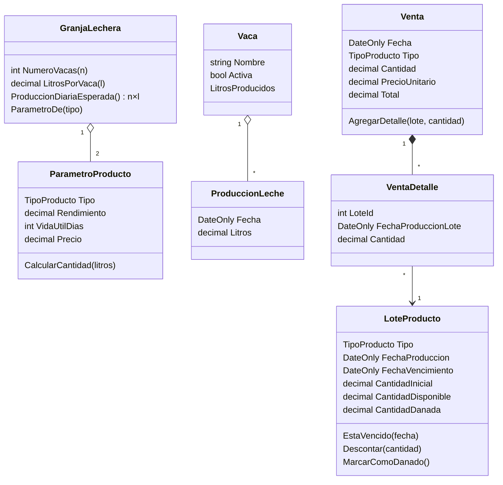

# Granja lechera — API Web en .NET con arquitectura en capas

Taller final de **Lenguajes de Programación** (Universidad Santiago de Cali).

La API gestiona una granja lechera: producción diaria de leche (n vacas × l litros), transformación de la leche en queso o yogurt, inventario por lotes con vencimiento, ventas con salida FIFO y reportes.

## Tecnologías

- .NET 10 / ASP.NET Core Web API (controllers)
- Entity Framework Core 10 + SQLite, con migraciones
- AutoMapper (mapeo de entidades a DTOs)
- Swagger / OpenAPI (Swashbuckle)
- ProblemDetails para el manejo global de errores
- xUnit para las pruebas (SQLite en memoria)

## Estructura de la solución

```text
Granja.sln
├── src/
│   ├── Granja.Domain           Entidades, enums, reglas, excepciones e interfaces (sin dependencias)
│   │   ├── Entities            GranjaLechera, ParametroProducto, Vaca, ProduccionLeche, LoteProducto, Venta, VentaDetalle
│   │   ├── Enums               TipoProducto, EstadoLote
│   │   ├── Exceptions          DomainException, ReglaNegocioException, EntidadNoEncontradaException,
│   │   │                       InventarioInsuficienteException, LecheInsuficienteException, ProduccionDuplicadaException
│   │   ├── Interfaces          IRepository<T>, IGranjaRepository, IVacaRepository, IProduccionRepository,
│   │   │                       ILoteRepository, IVentaRepository, IUnitOfWork, IClock
│   │   └── Rules               ReglasLeche (RN-02)
│   ├── Granja.Infrastructure   GranjaDbContext, configuraciones, migraciones, repositorios, UnitOfWork, SystemClock, seed
│   ├── Granja.Services         Servicios (casos de uso), DTOs, perfil de AutoMapper, lógica FIFO
│   └── Granja.Web              Controllers, Program.cs (DI), GlobalExceptionHandler, Swagger, Granja.Web.http
└── tests/
    └── Granja.Tests            Pruebas xUnit de dominio y de servicios
```

### Dependencias entre proyectos

```text
Granja.Web ──► Granja.Services ──► Granja.Domain
     │                                  ▲
     └──────► Granja.Infrastructure ────┘   (solo en Program.cs, como raíz de composición)
```

- **Domain** no conoce ninguna otra capa. Define las interfaces de repositorios, `IUnitOfWork` e `IClock`.
- **Infrastructure** implementa esas interfaces con EF Core.
- **Services** trabaja solo contra las interfaces del dominio (inversión de dependencias), así que se puede probar sin la base de datos real.
- **Web** referencia Infrastructure únicamente para registrar dependencias en `Program.cs`. Los controllers solo reciben la petición, llaman a un servicio y devuelven el resultado: nunca usan el `DbContext` ni contienen lógica de negocio.

> Decisión de diseño: el taller plantea `Web → Services → Infrastructure`. Aquí Services depende del **Dominio** (donde viven las interfaces de repositorio) y no de Infrastructure. Así se cumple la regla de que "las dependencias siempre apuntan hacia el dominio" y los servicios no quedan acoplados a EF Core.

## Modelo de dominio



**Cambios respecto al diagrama del enunciado** (Farm/Cow/Milk/Inventory/Product/Yogurt/Cheese):

- La herencia `Product → Yogurt / Cheese` se reemplaza por el enum `TipoProducto` más `ParametroProducto`. Ambos productos se comportan igual y solo cambian el rendimiento, la vida útil y el precio, que deben ser configurables y no quedar fijos en el código.
- `Inventory` no es una tabla: el inventario es el conjunto de `LoteProducto`. Cada lote guarda su fecha de producción, su vencimiento y sus cantidades inicial, disponible y dañada, que es lo que exige la salida FIFO.
- `Milk` pasa a ser `ProduccionLeche`, con un registro por vaca y por fecha (RN-01).
- La relación `Product * — 1 Venta` se modela con `VentaDetalle`: una venta puede tomar producto de varios lotes, lo que da la trazabilidad de RN-09.
- `Farm` pasa a ser `GranjaLechera`, que guarda n, l y los parámetros. Se cambió el nombre para no chocar con el namespace raíz `Granja`.

## Reglas de negocio implementadas

| Regla | Dónde vive |
|---|---|
| RN-01 producción n × l, una vez por fecha y vaca | `ProduccionService.RegistrarProduccionAsync` + índice único `(VacaId, Fecha)` |
| RN-02 litros transformados ≤ producidos del día | `ReglasLeche.ValidarTransformacion` → `LecheInsuficienteException` (409) |
| RN-03 cantidad = litros ÷ rendimiento | `ParametroProducto.CalcularCantidad` |
| RN-04 lote con fechas y cantidades | `LoteProducto.Crear` |
| RN-05 / RN-06 ventas ad libitum y FIFO | `ILoteRepository.ObtenerVendiblesAsync` (orden por FechaProduccion) + `VentaService` |
| RN-07 venta atómica | Se validan las existencias antes de tocar cualquier lote y todo se guarda con un único `IUnitOfWork.SaveChangesAsync` |
| RN-08 vencimiento y producto dañado | `LoteProducto.EstaVencido` / `MarcarComoDanado` + `InventarioService.ProcesarVencimientosAsync` |
| RN-09 trazabilidad | `Venta.AgregarDetalle` crea un `VentaDetalle` por lote |
| RN-10 fecha opcional | Todas las operaciones aceptan `fecha` y, si no se envía, usan `IClock.Today` |

Los valores por defecto (n = 10, l = 15, queso 10 L/kg con 30 días y precio 28.000, yogurt 1 L/L con 15 días y precio 6.000) se leen de la sección `GranjaSemilla` de `src/Granja.Web/appsettings.json` y se pueden cambiar con `PUT /api/granja`.

## Endpoints

### Operaciones

| Método | Ruta | Descripción | Respuestas |
|---|---|---|---|
| GET | `/api/granja` | Configuración (n, l) y parámetros por producto | 200 |
| PUT | `/api/granja` | Actualiza n, l, rendimiento, vida útil y precio (y ajusta las vacas activas a n) | 200, 400 |
| GET | `/api/vacas?incluirInactivas=` | Listado de vacas con los litros producidos | 200 |
| GET | `/api/vacas/{id}` | Consulta una vaca | 200, 404 |
| POST | `/api/produccion` | Registra la producción del día (`{ "fecha"? }`) | 201, 409 |
| GET | `/api/produccion?desde=&hasta=` | Producción por día | 200 |
| GET | `/api/produccion/{fecha}` | Producción de un día: producidos, transformados y disponibles | 200, 404 |
| POST | `/api/produccion/transformaciones` | Transforma leche en queso o yogurt y crea un lote | 201, 400, 404, 409 |
| GET | `/api/inventario?tipo=&soloDisponibles=&fecha=` | Lotes del inventario | 200 |
| GET | `/api/inventario/{id}` | Consulta un lote | 200, 404 |
| GET | `/api/inventario/resumen?fecha=` | Existencias vendibles, vencidas y dañadas por producto | 200 |
| GET | `/api/inventario/proximos-a-vencer?dias=3&fecha=` | Alerta de lotes próximos a vencer (extensión opcional) | 200 |
| POST | `/api/inventario/procesar-vencimientos` | Pasa a dañado el disponible de los lotes vencidos | 200 |
| POST | `/api/ventas` | Registra una venta FIFO | 201, 400, 409 |
| GET | `/api/ventas?desde=&hasta=&tipo=` | Lista las ventas | 200 |
| GET | `/api/ventas/{id}` | Consulta una venta con su detalle por lote | 200, 404 |

### Reportes

| Método | Ruta | Contenido |
|---|---|---|
| GET | `/api/reportes/ventas?desde=&hasta=&tipo=` | Ventas del período, totales por producto y total general |
| GET | `/api/reportes/leche-diaria?desde=&hasta=` | Leche producida por día, litros transformados y no aprovechados |
| GET | `/api/reportes/producto-diario?desde=&hasta=` | Producto elaborado por día y por tipo |
| GET | `/api/reportes/producto-total` | Por producto: producido, vendido, disponible, dañado e ingresos |
| GET | `/api/reportes/producto-danado?desde=&hasta=` | Producto dañado por lote y por tipo, con fecha de vencimiento |
| GET | `/api/reportes/vacas?desde=&hasta=` | Producción promedio, la vaca que más produce, la que menos y las que están por debajo del promedio |

Las fechas usan el formato ISO `yyyy-MM-dd` y los productos se escriben como texto (`"Queso"`, `"Yogurt"`).

### Ejemplo de venta

```http
POST /api/ventas
{ "tipoProducto": "Queso", "cantidad": 12, "fecha": "2026-12-03" }
```

Respuesta `201 Created`:

```json
{
  "id": 1, "fecha": "2026-12-03", "tipoProducto": "Queso", "cantidad": 12,
  "precioUnitario": 28000, "total": 336000,
  "detalle": [
    { "loteId": 1, "fechaProduccion": "2026-12-01", "cantidad": 10 },
    { "loteId": 3, "fechaProduccion": "2026-12-02", "cantidad": 2 }
  ]
}
```

### Manejo de errores

Todas las respuestas de error usan `ProblemDetails` (`application/problem+json`):

| Situación | Código |
|---|---|
| Validación de DTOs o `DomainException` (datos inválidos) | 400 |
| `EntidadNoEncontradaException` (venta, lote, vaca o producción inexistente) | 404 |
| `ReglaNegocioException`: producción duplicada, leche insuficiente o inventario insuficiente | 409 |
| Error no controlado | 500 |

## Cómo ejecutar

Requisitos: SDK de .NET 10.

```bash
dotnet restore
dotnet build
dotnet run --project src/Granja.Web --launch-profile http
```

- Swagger: <http://localhost:5161/swagger>. La raíz `/` redirige allí.
- Al arrancar se aplican las migraciones y, si la base está vacía, se crean la granja y las n vacas. La base SQLite queda en `src/Granja.Web/granja.db`; bórrala para empezar de cero.

### Colección de pruebas

`src/Granja.Web/Granja.Web.http` reproduce paso a paso el escenario de referencia del taller (§8), además de los casos 400, 404 y 409 y todos los reportes. Se ejecuta desde Visual Studio, Rider o VS Code (extensión REST Client).

### Migraciones

La herramienta se instala una sola vez con:

```bash
dotnet tool install --global dotnet-ef --version 10.0.11
```

Crear una migración nueva:

```bash
dotnet ef migrations add NombreMigracion --project src/Granja.Infrastructure --startup-project src/Granja.Web --output-dir Data/Migrations
```

Aplicarla a la base de datos:

```bash
dotnet ef database update --project src/Granja.Infrastructure --startup-project src/Granja.Web
```

## Pruebas unitarias

```bash
dotnet test
```

Las pruebas de servicios usan los servicios y repositorios reales sobre SQLite en memoria, con migraciones, y un `FakeClock` para simular los días. Cubren:

- Las pruebas mínimas del §9: producción n × l sin duplicados; no transformar más litros de los disponibles; FIFO sobre el lote más antiguo; una venta que consume varios lotes; un lote vencido nunca se vende; una venta insuficiente no modifica el inventario; procesar vencimientos actualiza el reporte.
- El escenario completo del §8, que verifica el reporte de producto total (Queso 25/12/13/0, Yogurt 50/20/0/30) y el de leche diaria (150 L el día 1 y 150 L el día 2).
- Las reglas del dominio (`LoteProducto`, `Venta`, `ReglasLeche`, `GranjaLechera`), la validez de los mapeos de AutoMapper, la configuración de la granja, el reporte de vacas y la alerta de lotes próximos a vencer.
